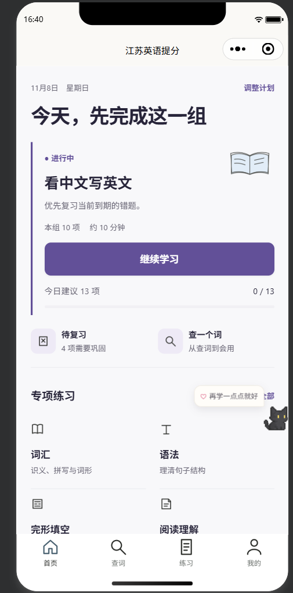
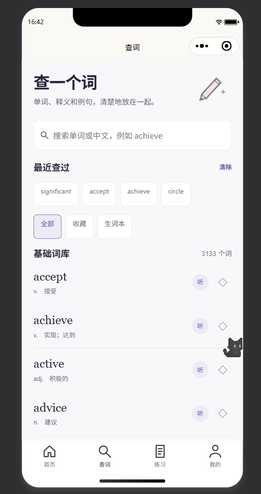
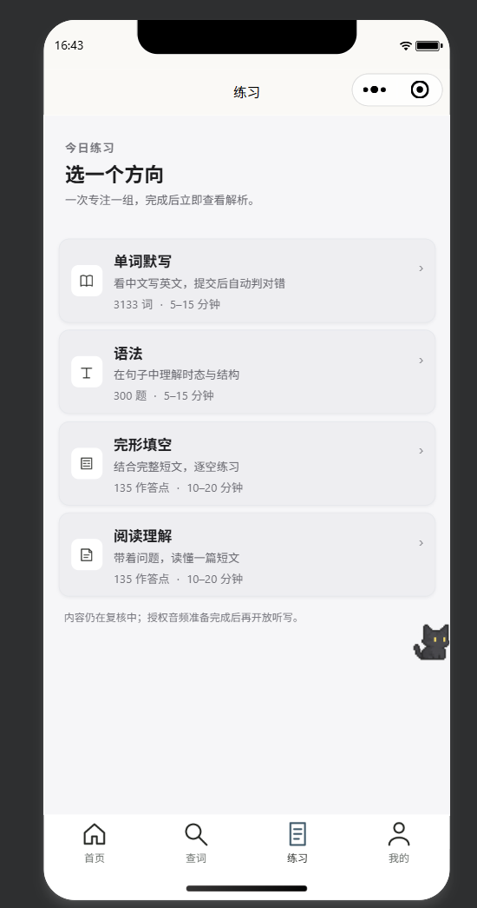
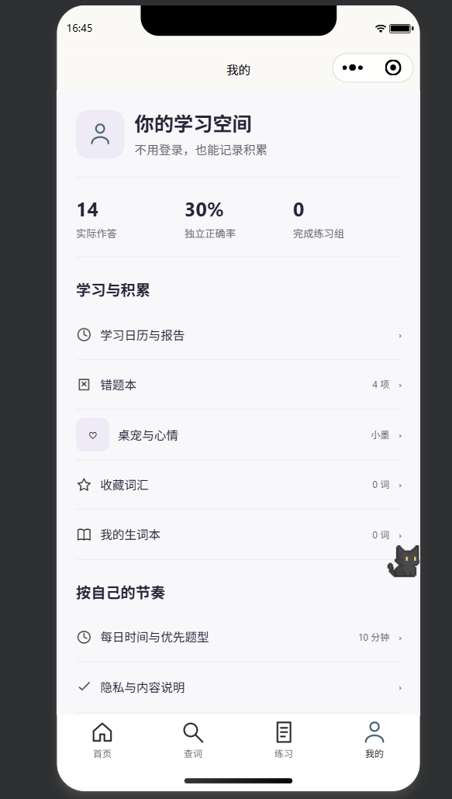

# Xiaolian | English Learning Mini Program

**A Self-Initiated Product & Content Operations Project**

A WeChat Mini Program designed to support high-school English learning through structured vocabulary, grammar, cloze, and reading exercises, with a focus on content organization, data quality, and user experience.

---

## 1. Project Overview

Xiaolian is an English learning product developed to make exam-oriented learning more structured, accessible, and measurable.

The project combines learning content management, searchable vocabulary resources, interactive exercises, and learning progress tracking.

## 2. Project Scope

| Component | Project Scale |
|---|---:|
| Searchable Dictionary Entries | 3,133 |
| Practice Questions | 600 |
| Learning Modules | 4 |
| Reading Passages | 25 |
| Cloze Passages | 25 |

### Core Learning Modules

- **Vocabulary:** Searchable English-Chinese dictionary and vocabulary practice.
- **Grammar:** Structured grammar exercises.
- **Cloze:** Context-based vocabulary and comprehension practice.
- **Reading:** Reading comprehension exercises.

## 3. My Role & Contributions

**Project Planning | Content Operations | Data Quality Assurance**

- Participated in defining the MVP scope and organizing product requirements.
- Structured vocabulary resources and categorized learning content.
- Organized and reviewed exercise materials for consistency and usability.
- Supported functional testing across learning modules and user flows.
- Identified content gaps, documented issues, and supported iterative improvements.
- Applied AI-assisted research and Python-supported workflows to improve data organization and validation.

## 4. Data Quality & Testing

Quality assurance was an important part of the project.

Key activities included:

- Vocabulary data consistency checks.
- Content completeness and accuracy reviews.
- Exercise answer and explanation validation.
- Functional testing of navigation and learning workflows.
- Issue tracking and iterative improvement.

The project uses a continuous review approach to improve content reliability and user experience.

## 5. Tools & Technologies

- **Data & Analysis:** Microsoft Excel, Python
- **AI Tools:** ChatGPT and AI-assisted workflows
- **Product:** WeChat Mini Program
- **Project Management:** GitHub
- **Documentation:** Markdown, Microsoft Word

## 6. Skills Demonstrated

- Data organization and quality assurance
- Content evaluation and information validation
- AI-assisted research and workflow optimization
- Product operations and MVP planning
- Structured problem-solving
- Documentation and project coordination

## 7. Project Status

The project has reached the MVP development and validation stage. Content quality, functional behavior, and user experience continue to be reviewed and improved.

**Note:** The figures above represent the documented project scope and may change as the product evolves.

## 8. Product Screenshots

The following screenshots demonstrate the main user-facing features of Xiaolian.

### 1. Home Page – Personalized Learning Dashboard

A daily learning dashboard that recommends study tasks, highlights learning priorities, and provides quick access to key learning modules.

### 2. Dictionary – Vocabulary Search & Management

An integrated English-Chinese dictionary with word search, recent search history, vocabulary browsing, and audio-assisted learning.

### 3. Practice Modules – Structured Learning

A modular learning interface covering four core areas: vocabulary, grammar, cloze exercises, and reading comprehension.

### 4. Learning Profile – Progress Tracking

A personal learning dashboard featuring practice statistics, accuracy tracking, error review, vocabulary collections, and study preferences.

------

*This repository presents a public-facing project overview. Original source code and learning datasets are maintained separately.*
